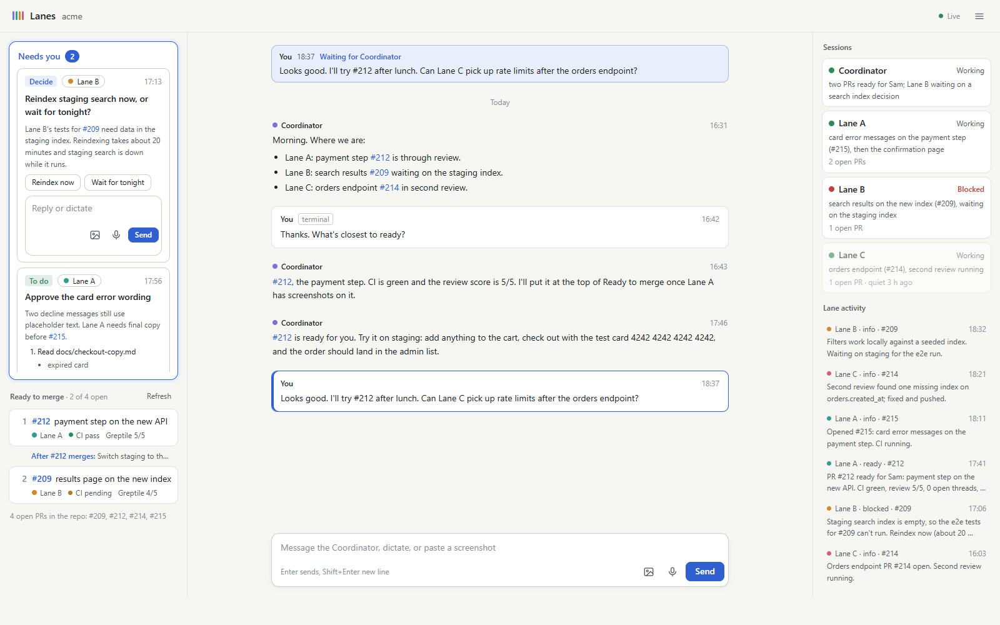
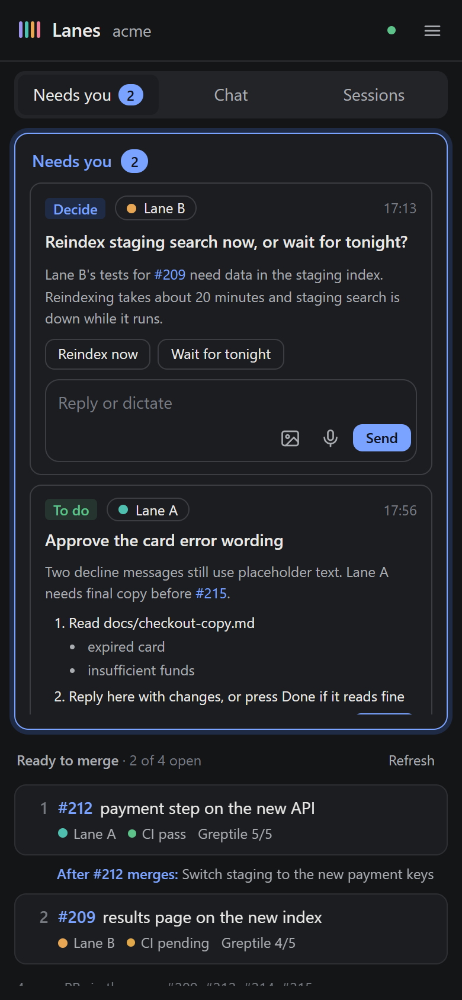

# Claude Lanes: Parallel Agents

`claude-lanes` runs a project with four Claude Code sessions at once: a **coordinator** you talk to, and three **lanes** (A, B, C) that each work their own area in their own git worktree. They share a small folder of plain text files (the plan, the rules, one status file per session), so any session can be restarted without losing its place.

This repo ships the workflow (a setup guide, templates and start commands) and a **local dashboard**: one page that shows what needs you, what's ready to merge, your chat with the coordinator, and what every session is doing.



## Quick start: the workflow

1. Clone this repo: `git clone https://github.com/Max-Walka/claude-lanes.git`
2. Read [docs/SETUP.md](docs/SETUP.md). It explains the setup and holds the message you paste into Claude Code in your project. Claude then writes the lanes folder (`~/.claude/lanes/<project>/`) from [templates/](templates/) and installs the `/coordinator` and `/lane` commands.
3. Start the four sessions: `/coordinator <project>`, `/lane a <project>`, `/lane b <project>`, `/lane c <project>`.

## Quick start: the dashboard

```
npm install
npm run demo        # made-up data on http://127.0.0.1:4318, to look around
cp config.example.json config.json   # then add your project
npm start           # http://127.0.0.1:4317
```

Needs Node 20 or later. For live PR state (CI, review score, open threads, merged or not), the GitHub CLI `gh` on PATH and signed in; without it, PRs show "PR state unavailable" and everything else works. The server listens on 127.0.0.1 only.

### Config

`config.json` (or the file named in the `LANES_CONFIG` env var):

```json
{
  "port": 4317,
  "person": "Sam",
  "projects": [
    { "name": "acme", "lanesFolder": "~/.claude/lanes/acme", "repoFolder": "~/code/acme" }
  ]
}
```

- `person`: the name the sessions use for you in `to` and `from` (default `User`). Your lines show as "You".
- `lanesFolder`: the shared folder with `plan.md`, the status files and the two `.jsonl` files.
- `repoFolder`: the project's git checkout. `gh` runs there, read-only.
- `port`: optional, default 4317. The `PORT` env var wins over it.
- `showModels`: optional, default `true`. Shows the model each session runs, on its card and (for the coordinator) by the send button. It is read, never changed, from the newest Claude Code transcript whose session name (`claude -n "Lane A"`) matches, in `~/.claude/projects` (or `transcriptsFolder`). Only the session name and the model id are read. To change a model, type `/model` in that session's terminal; the page cannot do it.
- More than one project adds a switcher to the top bar. Relative paths resolve from the config file's folder; `~` works.

## What the page shows

Everything fits on one screen; each column scrolls inside itself. Under about 1000px wide the columns become tabs.

- **Left: Needs you.** One list. "Question" cards are the coordinator's questions, with option buttons and a reply box. "To do" cards are follow-ups for you, with numbered steps and a Done button. One card shows at a time, with ‹ "1 of N" › and a count in the header. The card shows only its kind (Question or To do), lane, PR link, tags and its whole title; click it for a window with the text, steps and the option buttons or Done. Answering or pressing Done closes the window and shows the next card. Order: cards tagged `urgent` first, then `blocking`, then the rest, newest first within each. When a new card arrives the carousel jumps to it and it glows briefly. Tags come from an optional `tags` array on any line (`"tags":["urgent"]` is red, `["blocking"]` orange); `after:"merge"` to dos also get "after merge". A to do can carry SQL to run: `"sql":[{"title":"...","query":"...","expect":"..."}]`. The window then shows one query at a time with its title ("2 of 3: ..."), the query highlighted with its spacing and line breaks kept exactly, a Copy button and "Expect: ...". The arrow buttons or the Left and Right keys flip between queries. Needs you keeps its own space; Ready to merge never squashes it.
- **Left: Ready to merge.** One row per PR, in exactly the coordinator's latest merge order with its numbers, showing the plain name from the merge order's `labels` (else the GitHub title), owning lane, and CI and review score when GitHub answered. The PR number links to GitHub. Click a row for a window with what it does (the coordinator's latest `ready` line for it), anything to do before merging (its to dos without `after`), what to check on staging (its `after:"merge"` to dos) and the GitHub link. Only PRs in the latest merge order are listed, and the header counts them, e.g. "Ready to merge (2)". A PR a lane calls ready is not listed until the coordinator puts it in the merge order.
- **Centre: the chat.** You and the coordinator, laid out like a chat app: your messages (including what you type in its terminal, tagged "terminal") are bubbles on the right, its replies plain text on the left with a copy button. The reply box sits at the bottom: + adds an image, the mic dictates, and the coordinator's model shows beside the send button. Your latest message stays pinned at the top until the coordinator replies. Type, dictate with the mic, or paste or drop screenshots. The mic uses the browser's Web Speech API (Edge and Chrome), which sends the audio to the browser maker's online speech service; if dictation fails, the box says why (each step is also logged to the console as `[dictation]`). Windows voice typing (Win+H in the box) works as a fallback.
- **Right: Sessions.** One card per session: its state, its "Now" line and open PR count. A lane whose status file has a `State` line shows Working (with a rough "~N min left" and how long it has been on the task), Needs decision or Blocked (orange, with the question and when it will block, or the `Blocked on` line), Handing off or Stopped (red, "Needs restart: click its VS Code profile"), Done for today (grey, never stale), or any other `State` exactly as written (grey); click it to expand its task, start time, ETA, open PRs and what it finished today, with how long each took. Older status files without `State` show a dot (red blocked, blue waiting on you, green working). A card whose status file is over 15 minutes old gets a grey "stale" chip and fades (a red restart card never fades). The full status file, PRs and messages open in a drawer. The status file format is in `templates/status-file.md`. Below them, a small **Activity log** link opens every lane update, newest first, in a drawer (for debugging).
- **Menu:** `plan.md`, `rules.md`, `coordinator-rules.md`, read-only.

Files are watched and changes reach the page live (server-sent events). PR state is cached and refreshed every 60 seconds, or with Refresh. The page never changes code and never messages a session itself: it reads the lanes folder (and, for the model names, the start and end of recent Claude Code transcripts), and writes only `answers.jsonl` plus new files in `attachments/`.

## The two files

### `updates.jsonl` (sessions append, the page reads)

One JSON object per line. `ts` comes from the real clock, with an offset.

```json
{"ts":"2026-01-15T09:40:00+13:00","from":"Lane A","to":"Coordinator","kind":"ready","pr":212,"text":"PR #212 ready: payment step on the new API."}
{"ts":"2026-01-15T09:12:00+13:00","id":"q-0115-reindex","from":"Coordinator","to":"Sam","kind":"question","about":"Lane B","title":"Reindex staging search now, or wait for tonight?","text":"Lane B's tests need data in the staging index.","options":["Reindex now","Wait for tonight"]}
{"ts":"2026-01-15T09:50:00+13:00","id":"todo-0115-keys","from":"Coordinator","to":"Sam","kind":"todo","about":"Lane A","pr":212,"after":"merge","title":"Switch staging to the new payment keys","text":"Checkout fails on staging without them.","steps":["Open the staging environment variables","Set PAYMENTS_API_KEY","Redeploy staging"]}
{"ts":"2026-01-15T09:44:00+13:00","from":"Coordinator","to":"Sam","kind":"merge-order","prs":[212,209],"note":"#212 first","labels":{"212":"Pay by card on the new checkout","209":"Search uses the new index"}}
{"ts":"2026-01-15T08:41:00+13:00","id":"t-0115-0841","kind":"chat","from":"Sam","source":"terminal","to":"Coordinator","text":"What's closest to ready?"}
{"ts":"2026-01-15T08:42:00+13:00","from":"Coordinator","to":"Sam","kind":"chat","replyTo":"t-0115-0841","text":"#212, the payment step."}
{"ts":"2026-01-15T10:50:00+13:00","from":"Coordinator","to":"Sam","kind":"done","replyTo":"q-0115-reindex"}
```

| `kind` | Meaning | Shown |
| --- | --- | --- |
| `ready` | A PR is ready for you (`pr`). The coordinator's own `ready` line for a PR, in plain words, is its "What it does" | Ready to merge, Activity log |
| `blocked`, `info` | News | Chat if from the coordinator to you; the Activity log if from a lane |
| `chat` | A chat message; `from` you with `source:"terminal"` mirrors your terminal | Chat |
| `question` | A decision (`id`, `about`, `title`, `text`, `options`) | Needs you, as a Question card |
| `todo` | A follow-up (`id`, `about`, `pr`, `after:"merge"`, `title`, `text`, `steps`) | Needs you, as a To do card; with `after:"merge"`, once `pr` merges |
| `merge-order` | The merge order (`prs`, `note`, optional `labels`: PR number to a plain one-line name); the latest one wins | Orders and numbers the Ready to merge rows, and names them |
| `done` | Settles the question or to do whose `id` is `replyTo` | Greys it out, moves it to "Recently done" |

- `about` names the session a card concerns ("Lane A", or "Coordinator"); it turns that session's dot blue while a question is open.
- `steps` items may hold `"\n- "` sub-bullets. Chat text renders line breaks and `- ` bullets. `http` and `https` addresses become links.
- A coordinator line with `replyTo` set to one of your message ids is a reply to it and unpins it.
- Unknown fields are ignored. Lines that are not JSON objects are skipped.

### `answers.jsonl` (only the page appends)

```json
{"ts":"2026-01-15T10:36:00+13:00","id":"a-3f9c21d07b44","to":"Coordinator","text":"I'll try #212 after lunch."}
{"ts":"2026-01-15T10:41:00+13:00","id":"a-81c0e2a95d10","to":"Coordinator","replyTo":"q-0115-reindex","choice":0,"text":"Reindex now","attachments":["/home/sam/.claude/lanes/acme/attachments/a-81c0e2a95d10-1.png"]}
{"ts":"2026-01-15T11:02:00+13:00","id":"a-5b7e14c2f9a3","to":"Coordinator","replyTo":"todo-0115-keys","done":true,"text":"Done"}
```

- `to` is always `Coordinator`. The coordinator watches this file (see `templates/coordinator-rules.md`) and passes lines on.
- `replyTo`: the question or to do `id`. Left out for chat messages.
- `choice`: the option button's index, if the reply still starts with that option.
- `done: true`: the Done button on a to do.
- `attachments`: full paths of pasted or dropped images, saved as `<lanesFolder>/attachments/<id>-<n>.png` (other image types are converted to PNG). Up to 10 per message, 10 MB each.

## Repo layout

| Path | What |
| --- | --- |
| `docs/SETUP.md` | The workflow: how it works, how to set it up, your day, restarting, rules |
| `docs/DESIGN.md` | The dashboard's design spec |
| `templates/` | `plan.md`, `rules.md`, `coordinator-rules.md`, `status-file.md`, and the `/coordinator` and `/lane` commands |
| `server.js`, `lib/` | The Node server (no framework; one dependency, `marked`) |
| `public/` | The page: plain HTML, CSS and JS |
| `examples/` | The demo lanes folder and fake PR states used by `npm run demo` |

## Development

- `npm test`: unit tests for the parsers.
- `npm run demo`: the page on made-up data (port 4318), in a temp copy, so nothing real is touched.
- `npm run screenshots -- [url] [outDir]`: light and dark, wide and narrow screenshots with the installed Edge or Chrome (via `playwright-core`, a dev dependency that downloads no browser). Defaults to the demo.



## License

MIT. See [LICENSE](LICENSE).
